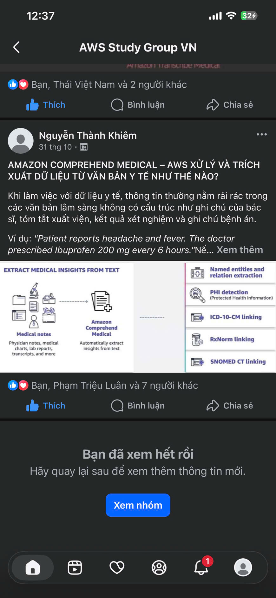

# Amazon Comprehend Medical – AWS xử lý và trích xuất dữ liệu từ văn bản y tế như thế nào?

Thông tin y tế thường nằm trong ghi chú của bác sĩ, tóm tắt xuất viện, kết quả xét nghiệm hoặc hồ sơ bệnh án dưới dạng văn bản tự do. Với câu “Patient reports headache and fever. The doctor prescribed Ibuprofen 200 mg every 6 hours.”, ứng dụng cần phân biệt triệu chứng, tên thuốc, liều lượng và tần suất sử dụng trước khi lưu thành dữ liệu có cấu trúc.

Amazon Comprehend Medical là dịch vụ xử lý ngôn ngữ tự nhiên (NLP) của AWS dành cho văn bản lâm sàng. Dịch vụ dùng mô hình được huấn luyện sẵn để phát hiện thực thể y tế và trả về kết quả cùng điểm tin cậy; nhà phát triển không cần tự huấn luyện mô hình cho bước nhận diện cơ bản.

## Amazon Comprehend Medical có gì đáng chú ý?

- **Phát hiện thực thể:** `DetectEntitiesV2` nhận diện tình trạng bệnh, thuốc, giải phẫu, thủ thuật và các thông tin liên quan trong văn bản. Kết quả có thể kèm thuộc tính như liều lượng, đường dùng hoặc tần suất.
- **Phát hiện PHI:** `DetectPHI` tìm các thông tin sức khỏe được bảo vệ, chẳng hạn tên, tuổi và ngày tháng. Ứng dụng vẫn phải tự thiết kế bước ẩn danh, quyền truy cập và quy trình xử lý dữ liệu.
- **Hiểu ngữ cảnh:** Các đặc tính như `NEGATION` giúp phân biệt “Patient denies fever” với trường hợp bệnh nhân thực sự bị sốt. Khi dùng kết quả, cần đọc cả thực thể và đặc tính đi kèm.
- **Liên kết thuật ngữ chuẩn:** `InferICD10CM`, `InferRxNorm` và `InferSNOMEDCT` đề xuất mã tương ứng cho tình trạng bệnh, thuốc hoặc thuật ngữ lâm sàng. Mã được đề xuất cần được kiểm tra trước khi đưa vào hồ sơ.

## Quy trình xử lý

1. Ứng dụng nhận văn bản lâm sàng, kiểm tra định dạng và xác định cách bảo vệ dữ liệu nhạy cảm.
2. Gọi API phù hợp để phát hiện thực thể, PHI hoặc liên kết với hệ thống mã y tế.
3. Đọc vị trí thực thể, thuộc tính, đặc tính ngữ cảnh và điểm tin cậy từ phản hồi.
4. Rà soát kết quả có độ tin cậy thấp hoặc có ảnh hưởng đến chăm sóc bệnh nhân, sau đó mới lưu vào cơ sở dữ liệu.

AWS hỗ trợ xử lý đồng bộ cho từng yêu cầu và xử lý bất đồng bộ cho tập tài liệu lưu trên Amazon S3. Có thể gọi dịch vụ qua AWS CLI hoặc SDK để tích hợp vào hệ thống hiện có.

## Trường hợp sử dụng

Dữ liệu có cấu trúc từ ghi chú lâm sàng có thể hỗ trợ tìm kiếm hồ sơ, tổng hợp thông tin cho quản lý ca bệnh, nghiên cứu lâm sàng và rà soát mã hóa y tế. Chẳng hạn, nhóm phát triển có thể tách tên thuốc và liều dùng để tạo một danh sách cần kiểm tra; kết quả nhận diện không tự trở thành chỉ định dùng thuốc.

Khi đầu vào là bản chép lời hội thoại, ứng dụng có thể dùng Amazon Transcribe Medical để chuyển giọng nói thành văn bản trước khi gọi Comprehend Medical. Nếu đầu vào là tài liệu quét, bước trích xuất chữ có thể được xử lý riêng bằng Amazon Textract. Đây là những tích hợp do ứng dụng xây dựng, không phải chức năng tự chạy bên trong Comprehend Medical.

## Những điểm cần lưu ý

Dịch vụ hiện nhận diện thực thể y tế trong văn bản **tiếng Anh Mỹ (US-EN)**, chưa hỗ trợ trực tiếp tiếng Việt. Kết quả có điểm tin cậy, nhưng điểm này không thay thế đánh giá chuyên môn. Theo AWS, kết quả dùng trong chăm sóc bệnh nhân phải được nhân viên y tế có chuyên môn kiểm tra về độ chính xác và tính phù hợp.

Văn bản có thể chứa PHI. Khi triển khai, cần kiểm soát quyền truy cập, mã hóa, lưu trữ và xử lý dữ liệu theo yêu cầu của tổ chức. Khả năng đủ điều kiện sử dụng trong môi trường HIPAA của dịch vụ không đồng nghĩa toàn bộ ứng dụng tự động tuân thủ HIPAA.

Chi phí được tính theo mức sử dụng API và có thể thay đổi theo loại tác vụ, Region và các dịch vụ đi kèm. Nên xem bảng giá AWS tại thời điểm triển khai thay vì dùng một mức giá cố định trong báo cáo.

## Kết luận

Amazon Comprehend Medical giúp chuyển văn bản lâm sàng tự do thành các thực thể và mã y tế có thể xử lý bằng phần mềm. Giá trị của dịch vụ nằm ở bước hỗ trợ trích xuất và chuẩn hóa; việc kiểm tra kết quả, bảo vệ dữ liệu và quyết định lâm sàng vẫn cần quy trình của con người.

## Nguồn tham khảo

- [AWS – What is Amazon Comprehend Medical?](https://docs.aws.amazon.com/comprehend-medical/latest/dev/comprehendmedical-welcome.html)
- [AWS – How Amazon Comprehend Medical works](https://docs.aws.amazon.com/comprehend-medical/latest/dev/comprehendmedical-howitworks.html)
- [AWS – Amazon Comprehend Medical pricing](https://aws.amazon.com/comprehend/medical/pricing/)

## Ảnh bài đăng

