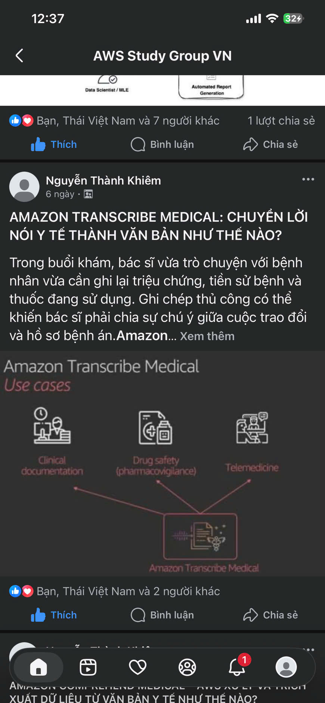

# Amazon Transcribe Medical: Turning medical speech into text

During an appointment, a clinician may need to document symptoms, medical history, and medications while speaking with a patient. Manual notes can divide attention between the conversation and the medical record.

Amazon Transcribe Medical is an AWS automatic speech recognition service for medical speech. It converts dictation or conversations into draft transcripts for a healthcare professional to review and correct.

## Main capabilities

- **Medical dictation:** Transcribes a clinician's spoken notes.
- **Medical conversation:** Transcribes a conversation between a clinician and a patient.
- **Speaker diarization:** Labels speaker turns, such as `spk_0` and `spk_1`; it does not identify which speaker is the clinician.
- **Medical custom vocabulary:** Helps recognize specialized terms. Do not put confidential information or PHI in the vocabulary.
- **Alternative transcriptions:** Provides other recognition candidates when audio is unclear.
- **PHI identification:** Marks personal health information in the transcript. Redaction is a separate step.

## Workflow

1. Capture speech through a microphone or an audio file.
2. Send the audio through a streaming or batch transcription workflow.
3. Receive a transcript and any configured speaker labels or additional details.
4. Have a healthcare professional check and edit the transcript before use.

## AWS integrations

An application may store audio and transcripts in Amazon S3, orchestrate processing with AWS Lambda, extract structured clinical information with Amazon Comprehend Medical, or add a separately designed summarization or question-answering stage with Amazon Bedrock. These integrations do not run automatically inside Transcribe Medical.

## Limitations and cost

The service supports **US English (`en-US`)**, not direct Vietnamese transcription. Batch transcription supports Primary Care specialties, including family medicine, internal medicine, obstetrics and gynecology, and pediatrics. Some other specialties are streaming only. Noise, pronunciation, and technical terms can affect accuracy.

Audio and transcripts may contain sensitive health data. Access and storage need appropriate controls, and a healthcare professional must review transcripts used in patient care. Pricing is based on transcribed audio duration; check the current AWS pricing page for the applicable rate.

## References

- [AWS – Amazon Transcribe Medical](https://docs.aws.amazon.com/transcribe/latest/dg/transcribe-medical.html)
- [AWS – Transcribing a medical conversation](https://docs.aws.amazon.com/transcribe/latest/dg/transcribe-medical-conversation.html)
- [AWS – Transcribing a medical dictation](https://docs.aws.amazon.com/transcribe/latest/dg/transcribe-medical-dictation.html)
- [AWS – Medical custom vocabularies](https://docs.aws.amazon.com/transcribe/latest/dg/vocabulary-med.html)
- [AWS – Amazon Transcribe pricing](https://aws.amazon.com/transcribe/pricing/)

## Published post

- **Facebook Post (AWS Study Group VN):** [View post](https://www.facebook.com/share/p/1DyfF49vW6/)

