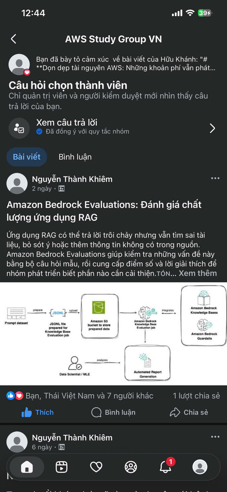

# Amazon Bedrock Evaluations: Assessing RAG applications

A retrieval augmented generation (RAG) application may produce fluent answers while retrieving the wrong documents, omitting important points, or adding claims absent from its sources. Amazon Bedrock Evaluations helps teams test these problems with a question set and inspect scores and explanations.

## Evaluation modes

Amazon Bedrock uses an evaluator model to assess a RAG system. The team prepares test questions, selects a RAG source and metrics, and runs an evaluation job. For a Knowledge Base evaluation, the test dataset is stored in Amazon S3; results can be inspected in the Bedrock Console and saved to S3.

- **Retrieve only:** Measures the relevance and coverage of retrieved documents.
- **Retrieve and generate:** Assesses both retrieval and generated answers.

## How scoring works

Each metric has its own evaluation prompt and criteria. Depending on the metric, the evaluator may inspect the question, retrieved passages, generated answer, and a reference answer when available. It returns a rating and explanation; Bedrock maps ratings to a 0–1 score and can aggregate results across the question set.

Interpret the direction of each metric carefully. Higher Correctness, Completeness, Helpfulness, and Faithfulness scores are generally better. Higher Harmfulness, Stereotyping, or Refusal scores can indicate more problematic responses.

## Metrics

**Retrieve only:** Context relevance asks whether retrieved passages relate to the question. Context coverage asks whether they include the information in a reference answer; this metric requires a reference answer.

**Retrieve and generate:** Correctness measures accuracy; Completeness measures whether all aspects are addressed; Helpfulness measures utility; Logical coherence checks consistency; Faithfulness checks whether claims are supported by retrieved text. Citation precision and Citation coverage assess citations. Harmfulness, Stereotyping, and Refusal check undesirable response behavior. Correctness and Completeness can be evaluated without a reference answer, although one provides an additional comparison.

## Running an evaluation

1. Prepare test questions and optional reference answers.
2. For a Knowledge Base, format the dataset as AWS JSONL with `conversationTurns`, a `prompt`, and optional `referenceResponses`.
3. Upload the file to Amazon S3 and configure the RAG source, evaluation mode, evaluator model, and metrics in Bedrock. Select a generator model when the job generates responses.
4. Run the job and inspect both aggregate scores and per-question explanations.

Bedrock can also evaluate inference data supplied from an external RAG system.

## Using the results

Low Context relevance suggests reviewing retrieval and chunking. Low Faithfulness calls for comparing generated claims against retrieved passages. Low Completeness points to missing parts of the expected answer. After changing data, retrieval settings, prompts, or the generator model, rerun the same question set to compare outcomes. This is a batch evaluation process, not automatic real-time monitoring.

Costs depend on evaluator-model tokens and associated services. Knowledge Base operations and generated responses can add charges. Check current AWS pricing before running large datasets.

## References

- [AWS Machine Learning Blog – Evaluating RAG applications](https://aws.amazon.com/blogs/machine-learning/evaluating-rag-applications-with-amazon-bedrock-knowledge-base-evaluation/)
- [AWS – RAG evaluation metrics](https://docs.aws.amazon.com/bedrock/latest/userguide/knowledge-base-evaluation-metrics.html)
- [AWS – Review RAG evaluation metrics](https://docs.aws.amazon.com/bedrock/latest/userguide/knowledge-base-eval-llm-results.html)
- [AWS – Evaluate RAG sources](https://docs.aws.amazon.com/bedrock/latest/userguide/evaluation-kb.html)
- [AWS – Evaluator prompts](https://docs.aws.amazon.com/bedrock/latest/userguide/kb-eval-prompt.html)
- [AWS – Amazon Bedrock pricing](https://aws.amazon.com/bedrock/pricing/)

## Published post

- **Facebook Post (AWS Study Group VN):** [View post](https://www.facebook.com/share/p/1EVQch9qX5/)

