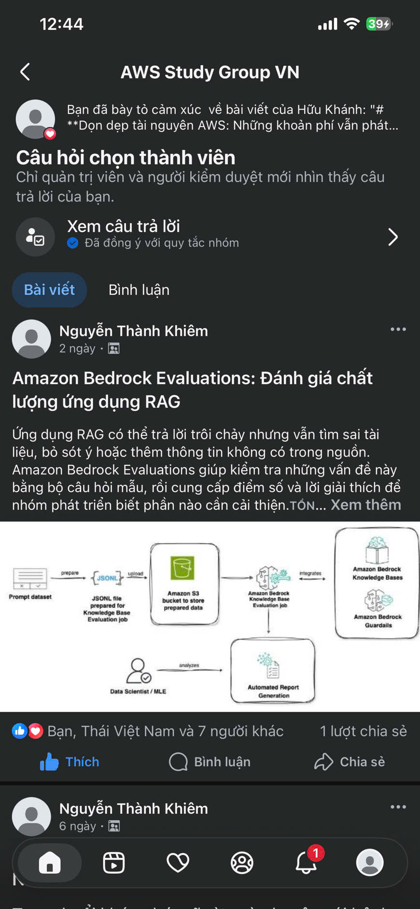

# Amazon Bedrock Evaluations: Đánh giá chất lượng ứng dụng RAG

Ứng dụng RAG có thể trả lời trôi chảy nhưng vẫn tìm sai tài liệu, bỏ sót ý hoặc thêm thông tin không có trong nguồn. Amazon Bedrock Evaluations giúp kiểm tra những vấn đề này bằng bộ câu hỏi mẫu, sau đó cung cấp điểm số và lời giải thích để nhóm phát triển xác định phần cần cải thiện.

## Tổng quan về các tính năng

Amazon Bedrock dùng mô hình ngôn ngữ làm giám khảo cho tác vụ đánh giá RAG. Nhóm phát triển chuẩn bị bộ câu hỏi, chọn nguồn RAG và các chỉ số muốn kiểm tra. Với Knowledge Base, dữ liệu kiểm thử được lưu trên Amazon S3; kết quả có thể xem trong Bedrock Console và lưu trên S3.

Bedrock hỗ trợ hai chế độ:

- **Retrieve only:** Đánh giá mức độ liên quan và độ bao phủ của tài liệu được truy xuất.
- **Retrieve and generate:** Đánh giá cả tài liệu truy xuất lẫn câu trả lời do hệ thống tạo ra.

## Mô hình giám khảo chấm điểm như thế nào?

Mỗi chỉ số có prompt và tiêu chí đánh giá riêng. Tùy chỉ số, mô hình giám khảo có thể xem câu hỏi, tài liệu truy xuất, câu trả lời của ứng dụng và câu trả lời tham chiếu nếu có. Kết quả gồm mức đánh giá, phần giải thích và điểm được quy đổi về thang 0–1; báo cáo có thể tổng hợp điểm trên bộ câu hỏi.

Cần đọc đúng chiều của từng chỉ số. Điểm cao thường tốt với Correctness, Completeness, Helpfulness và Faithfulness. Ngược lại, điểm cao ở Harmfulness, Stereotyping hoặc Refusal có thể báo hiệu nhiều nội dung gây hại, định kiến hoặc né tránh câu hỏi hơn.

## Các chỉ số đánh giá

**Retrieve only:**

- **Context relevance:** Tài liệu truy xuất có liên quan đến câu hỏi không?
- **Context coverage:** Tài liệu truy xuất có bao phủ thông tin trong câu trả lời tham chiếu không? Chỉ số này cần câu trả lời tham chiếu.

**Retrieve and generate:**

- **Correctness:** Câu trả lời có chính xác không?
- **Completeness:** Câu trả lời có giải quyết đủ các ý không?
- **Helpfulness:** Câu trả lời có hữu ích không?
- **Logical coherence:** Lập luận có mạch lạc, nhất quán không?
- **Faithfulness:** Câu trả lời có bám vào tài liệu truy xuất không?
- **Citation precision và Citation coverage:** Trích dẫn có đúng và hỗ trợ đủ các ý trong câu trả lời không?
- **Harmfulness, Stereotyping và Refusal:** Câu trả lời có chứa nội dung gây hại, định kiến hoặc né tránh câu hỏi không?

Correctness và Completeness có thể được chấm khi không có câu trả lời tham chiếu; nếu có, giám khảo có thêm dữ liệu để đối chiếu.

## Quy trình đánh giá trên Amazon Bedrock

1. Chuẩn bị bộ câu hỏi kiểm thử, có thể kèm câu trả lời tham chiếu.
2. Với Knowledge Base, định dạng dữ liệu thành JSONL theo schema AWS. Mỗi dòng chứa `conversationTurns`, bên trong có `prompt` và có thể có `referenceResponses`.
3. Tải tệp lên Amazon S3. Trong Bedrock Console, chọn nguồn RAG, chế độ đánh giá, mô hình giám khảo và các chỉ số; ở chế độ tạo câu trả lời, chọn thêm mô hình tạo sinh nếu cần.
4. Chạy tác vụ rồi đọc báo cáo tổng quan cùng kết quả chi tiết cho từng câu hỏi.

AWS cũng hỗ trợ đưa dữ liệu suy luận từ hệ thống RAG bên ngoài vào để đánh giá.

## Đọc kết quả và cải thiện ứng dụng

Một điểm số riêng lẻ chưa cho biết nguyên nhân. Nếu Context relevance thấp, nhóm có thể xem lại cách chia đoạn và truy xuất. Nếu Faithfulness thấp, cần đối chiếu câu trả lời với tài liệu được tìm thấy. Nếu Completeness thấp, hãy xem ứng dụng bỏ sót thông tin nào trong câu trả lời tham chiếu.

Sau khi sửa dữ liệu, cấu hình truy xuất, prompt hoặc mô hình tạo sinh, có thể chạy lại cùng bộ câu hỏi để so sánh. Đây là tác vụ đánh giá theo lô, phù hợp kiểm tra định kỳ sau thay đổi; nó không tự giám sát từng câu trả lời theo thời gian thực.

## Chi phí

Chi phí phụ thuộc vào mô hình giám khảo, lượng token xử lý và các dịch vụ được sử dụng. Khi đánh giá Knowledge Base, cần tính thêm chi phí vận hành Knowledge Base; chế độ Retrieve and generate có thể phát sinh phí suy luận của mô hình tạo câu trả lời. Nên kiểm tra bảng giá AWS trước khi chạy trên bộ dữ liệu lớn.

## Nguồn tham khảo

- [AWS Machine Learning Blog – Evaluating RAG applications with Amazon Bedrock Knowledge Base Evaluation](https://aws.amazon.com/blogs/machine-learning/evaluating-rag-applications-with-amazon-bedrock-knowledge-base-evaluation/)
- [AWS – Use metrics to understand RAG system performance](https://docs.aws.amazon.com/bedrock/latest/userguide/knowledge-base-evaluation-metrics.html)
- [AWS – Review metrics for RAG evaluations that use LLMs](https://docs.aws.amazon.com/bedrock/latest/userguide/knowledge-base-eval-llm-results.html)
- [AWS – Evaluate the performance of RAG sources](https://docs.aws.amazon.com/bedrock/latest/userguide/evaluation-kb.html)
- [AWS – Evaluator prompts used in a RAG evaluation job](https://docs.aws.amazon.com/bedrock/latest/userguide/kb-eval-prompt.html)
- [AWS – Amazon Bedrock pricing](https://aws.amazon.com/bedrock/pricing/)

## Ảnh bài đăng

