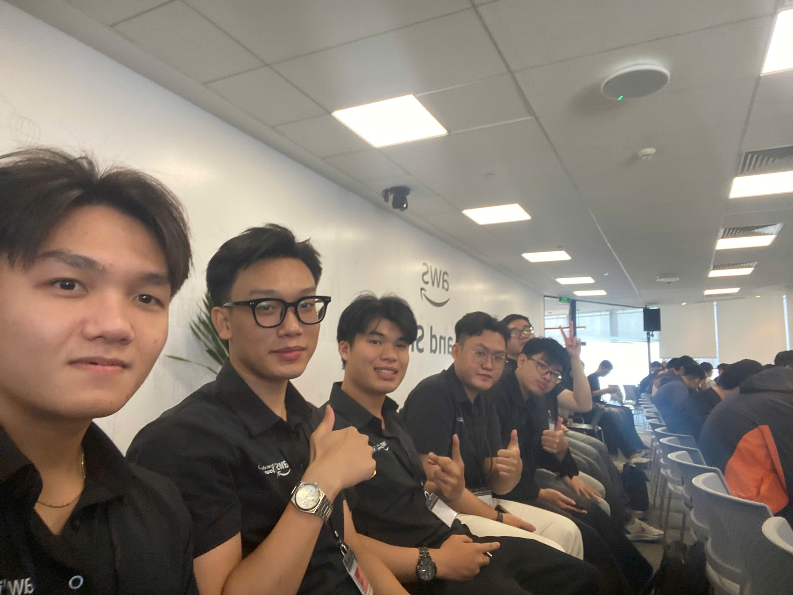
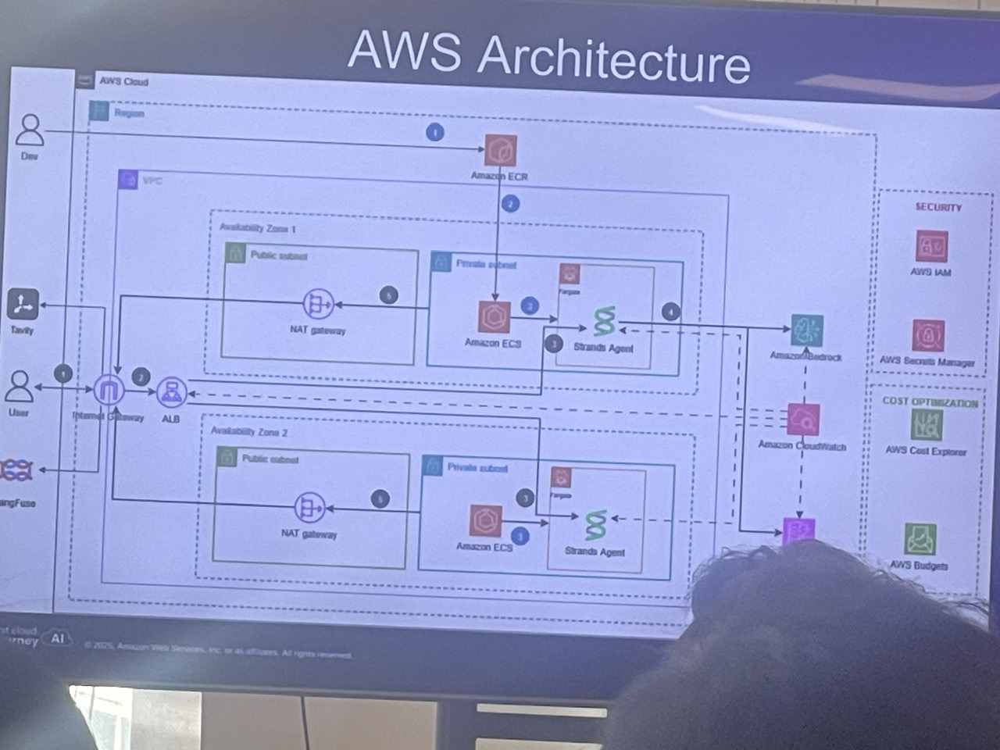
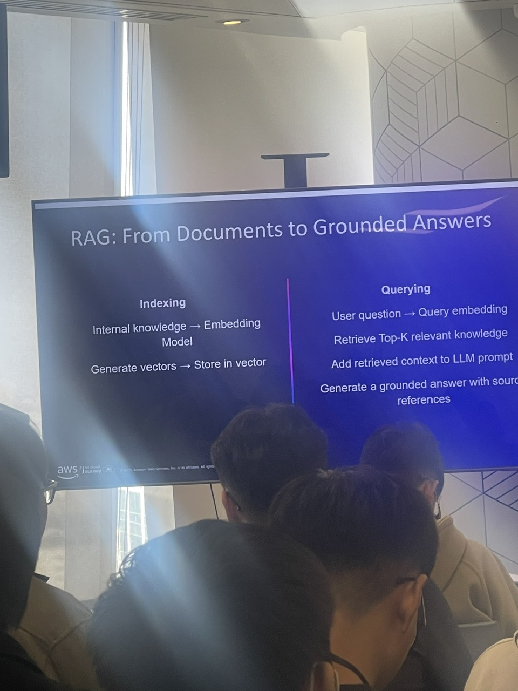
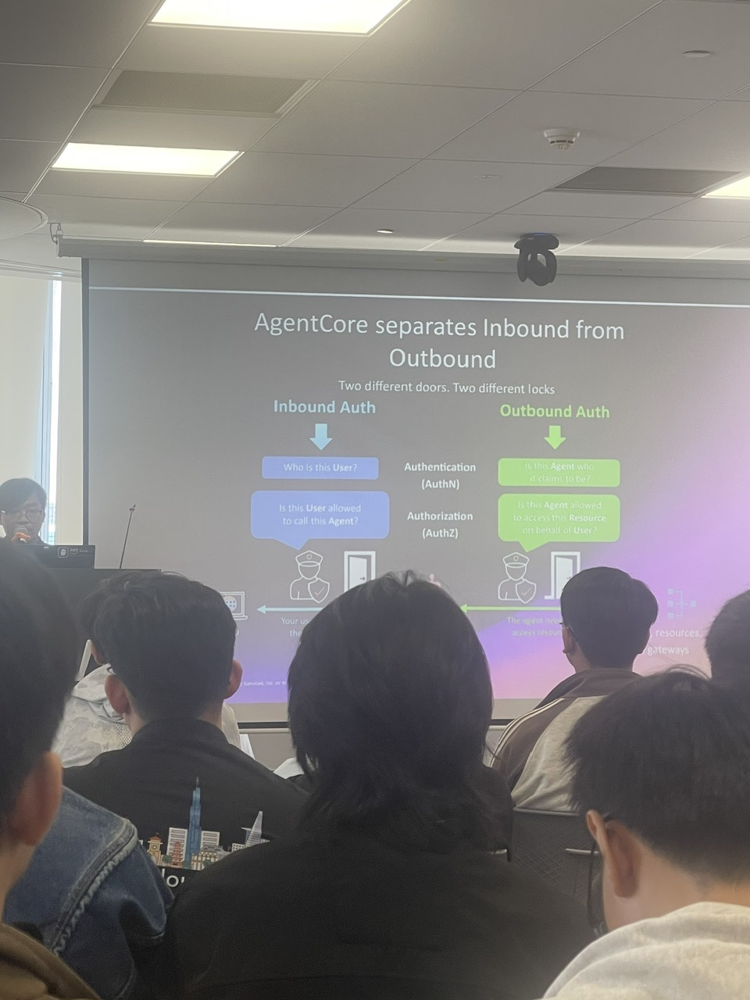

# From Prototype to Production

## Event Information

- **Session:** From Prototype to Production — Secure, Reliable, Scalable Enterprise AI on the Cloud.
- **Date:** Wednesday, October 14, 2026.
- **My role:** Attendee.

The session used a restaurant example to explain how a working AI prototype becomes a service that can handle real users. The model is one part of the product. The surrounding system has to protect data, handle changes in demand, and recover when a dependency fails.

## 1. Designing for production

The presenters grouped production concerns into security, scalability, reliability, and cost. They discussed AWS KMS for encryption, IAM for access control, and guardrails for AI-specific risks. They also showed how load balancing and Auto Scaling can handle changes in traffic. Health checks, retries, and failover help the service recover, while caching and using a smaller model for simpler tasks can reduce cost.

## 2. Running agents with Amazon Bedrock AgentCore

The AgentCore examples covered running agent sessions with Runtime, connecting agents to tools through Gateway, and retaining relevant context with Memory. The authorization slides distinguished the permission to call an agent from the permission the agent needs to access a downstream resource. A hybrid support example showed a local component working with an agent on AWS while the ticket system stayed on premises.

## 3. Grounding answers and reviewing actions

The RAG example separated document indexing from query-time retrieval. The application retrieves relevant passages and passes them to the model so the answer can cite its sources. A Strands and FastAPI example showed a router delegating policy questions, ticket drafting, and research to different agents. The ticket workflow included a human approval step. The presenters also used Langfuse as an example of tracing tool calls and investigating slow or failed requests.

## 4. How the pieces fit together

### Agent context, retrieval, and memory

The session broke down an agent's context into instructions, conversation history, retrieved documents, available tools, and memory. The RAG slides described two separate stages. During indexing, an embedding model turns document passages into vectors. At query time, the system embeds the question, retrieves the top matching passages, and gives those passages to the model as evidence. This made it easier for me to see where a bad answer can originate. The retriever may return the wrong passage, or the model may misinterpret a relevant one.

The memory example distinguished short-term conversation messages and session state from information that can be recalled across sessions, such as preferences or summaries. Longer retention raises questions about stale information, retrieval accuracy, and privacy. For MediMind, I would define what belongs to a consultation session and what may be saved to the user's account before considering cross-session memory.

### Tool permissions and human approval

The Gateway example separated inbound authorization from outbound authorization. Inbound checks determine who may invoke the agent. Outbound checks govern which downstream resource the agent may access for that request. The hybrid ticket example put this distinction into practice. An on-premises component pulled tickets and posted replies, while an agent running on AWS worked with the information and tools it was allowed to use.

In the Strands example, a FastAPI entry point routed policy questions, ticket requests, and research to specialized agents. Looking up a policy, drafting a ticket, and submitting it are different operations. The ticket draft went through an approval step before submission. I can apply the same distinction to OCR in MediMind by showing extracted fields for review before the user confirms saving the record or creating a reminder.

### Deployment, reliability, and cost

The example AWS architecture showed container images stored in Amazon ECR, workloads running on Amazon ECS with AWS Fargate across two Availability Zones, and an Application Load Balancer in front. It also illustrated how IAM and Secrets Manager fit into deployment and how AWS Budgets supports cost control. I treated this as an architecture discussed in the workshop and used it to compare deployment options for the project.

The production discussion tied health checks, retries, and failover to specific failure cases. For example, a temporarily unavailable dependency should produce a clear response, while retries need limits so they do not multiply load. The session also compared selecting smaller models for simpler requests and caching repeated work. Both choices need to be evaluated against answer quality, latency, and cost.

### Measuring an agent workflow

The Langfuse example showed how traces help identify whether time was spent on retrieval, a model request, or a tool call. That makes it possible to investigate slow or failed requests at the step where they occurred. For the project, I would track source relevance, citation accuracy, and time spent per processing step on synthetic test cases.

## What I took away

For MediMind Clinical AI, I would test retrieval quality separately from answer quality and verify that citations match the retrieved text. I would keep user confirmation before saving uncertain OCR results and test how the application responds when an external provider is unavailable. These checks give me specific ways to assess the prototype before expanding its use.

## Event photos

