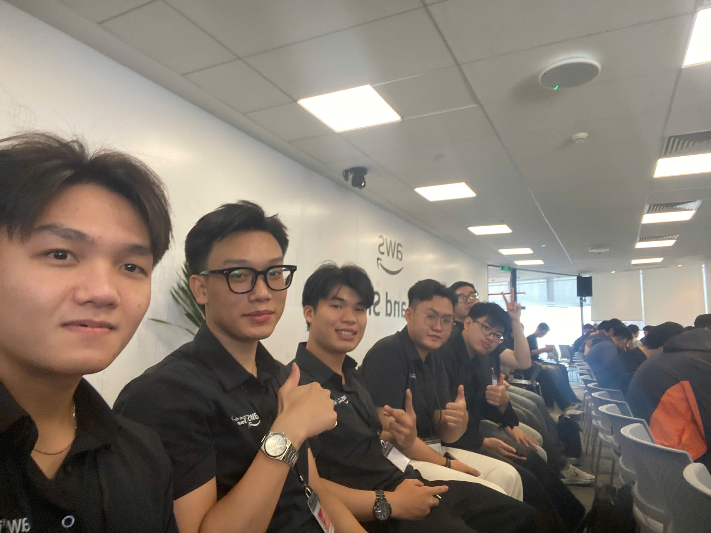
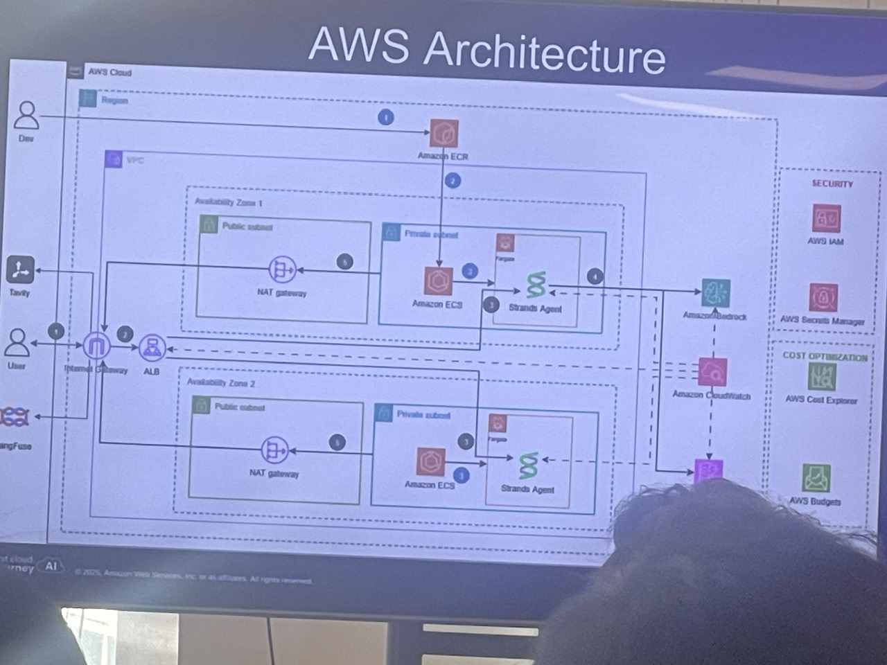
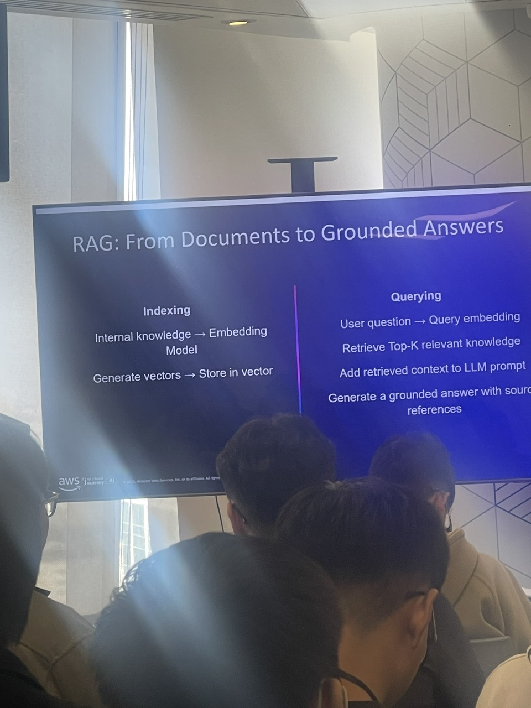
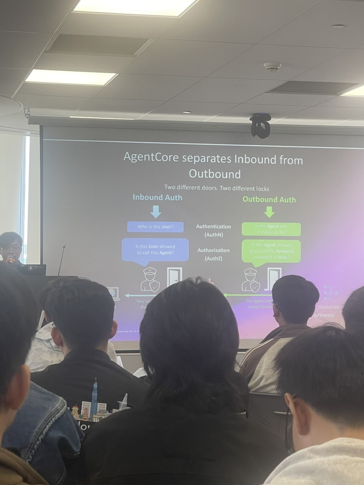

# From Prototype to Production

## Thông tin sự kiện

- **Chủ đề:** From Prototype to Production — Xây dựng AI doanh nghiệp an toàn, tin cậy và có khả năng mở rộng trên cloud.
- **Thời gian:** Thứ Bảy, ngày 14/11/2026.
- **Địa điểm:** Tầng 26, văn phòng AWS tại TP. Hồ Chí Minh.
- **Vai trò của tôi:** Người tham dự.

Buổi chia sẻ dùng ví dụ nhà hàng để giải thích quá trình đưa một nguyên mẫu AI vào vận hành thực tế. Mô hình chỉ là một phần của sản phẩm. Hệ thống còn phải bảo vệ dữ liệu, đáp ứng lưu lượng thay đổi và phục hồi khi dịch vụ phụ thuộc gặp lỗi.

## 1. Thiết kế hệ thống để vận hành thực tế

Các diễn giả trình bày bốn yêu cầu gồm bảo mật, khả năng mở rộng, độ tin cậy và chi phí. Phần bảo mật đề cập AWS KMS để mã hóa, IAM để phân quyền và guardrails để kiểm soát rủi ro riêng của AI. Cân bằng tải và Auto Scaling giúp ứng dụng thích ứng với lưu lượng. Health check, thử lại và chuyển sang tài nguyên dự phòng giúp hệ thống phục hồi, còn bộ nhớ đệm và mô hình nhỏ cho tác vụ đơn giản có thể giảm chi phí.

## 2. Vận hành agent với Amazon Bedrock AgentCore

Các ví dụ về AgentCore đề cập Runtime để chạy phiên agent, Gateway để kết nối công cụ và Memory để giữ ngữ cảnh cần thiết. Phần phân quyền tách quyền gọi agent của người dùng khỏi quyền truy cập tài nguyên mà agent cần để thực hiện yêu cầu. Một ví dụ kiến trúc lai minh họa cách thành phần nội bộ phối hợp với agent trên AWS trong khi hệ thống ticket vẫn đặt tại chỗ.

## 3. Truy xuất tài liệu và kiểm soát hành động

Ví dụ RAG tách bước lập chỉ mục tài liệu khỏi bước truy xuất theo câu hỏi. Ứng dụng tìm các đoạn liên quan rồi đưa chúng vào ngữ cảnh của mô hình để câu trả lời có thể dẫn nguồn. Ví dụ với Strands và FastAPI cho thấy bộ định tuyến chuyển câu hỏi chính sách, yêu cầu soạn ticket và yêu cầu nghiên cứu tới các agent khác nhau. Luồng ticket có bước phê duyệt của con người. Diễn giả cũng minh họa cách dùng Langfuse để theo dõi lượt gọi công cụ và tìm nguyên nhân khi yêu cầu bị chậm hoặc lỗi.

## 4. Các thành phần phối hợp trong một hệ thống AI

### Ngữ cảnh, truy xuất tài liệu và bộ nhớ

Buổi chia sẻ phân tích ngữ cảnh của agent thành chỉ dẫn, lịch sử hội thoại, tài liệu truy xuất, công cụ và bộ nhớ. Slide RAG mô tả hai giai đoạn riêng. Khi lập chỉ mục, mô hình embedding chuyển các đoạn tài liệu thành vector. Khi nhận câu hỏi, hệ thống tạo vector cho truy vấn, lấy các đoạn phù hợp nhất rồi đưa vào ngữ cảnh để mô hình trả lời có căn cứ. Qua đó, tôi thấy có thể lần theo nguyên nhân của một câu trả lời sai. Bộ truy xuất có thể lấy nhầm đoạn hoặc mô hình có thể diễn giải sai dù đã nhận đúng tài liệu.

Phần Memory phân biệt trạng thái và tin nhắn trong phiên với thông tin cần truy xuất ở phiên sau, chẳng hạn sở thích hoặc bản tóm tắt. Lưu thông tin lâu hơn đặt ra câu hỏi về dữ liệu lỗi thời, độ chính xác khi truy xuất và quyền riêng tư. Với MediMind, tôi sẽ xác định dữ liệu nào chỉ phục vụ phiên tư vấn và dữ liệu nào có thể lưu vào tài khoản trước khi cân nhắc ghi nhớ qua nhiều phiên.

### Quyền gọi công cụ và phê duyệt của con người

Ví dụ Gateway tách quyền người dùng gọi agent khỏi quyền agent truy cập tài nguyên để xử lý yêu cầu. Tình huống hỗ trợ theo kiến trúc lai minh họa sự phân tách đó. Thành phần tại chỗ lấy ticket và đăng phản hồi, còn agent trên AWS làm việc với thông tin và công cụ đã được cấp quyền.

Trong ví dụ Strands, FastAPI tiếp nhận yêu cầu và bộ định tuyến chuyển câu hỏi chính sách, yêu cầu soạn ticket hoặc yêu cầu nghiên cứu đến từng agent chuyên trách. Tra cứu chính sách, soạn nháp và gửi ticket là các thao tác khác nhau. Bản nháp cần được duyệt trước khi gửi. Tôi có thể áp dụng cách phân tách này cho OCR trong MediMind bằng việc hiển thị dữ liệu trích xuất để người dùng kiểm tra trước khi xác nhận lưu hoặc tạo nhắc nhở.

### Triển khai, độ tin cậy và chi phí

Sơ đồ AWS minh họa cách lưu container image ở Amazon ECR, chạy ứng dụng trên Amazon ECS với AWS Fargate qua hai Availability Zone và dùng Application Load Balancer để tiếp nhận lưu lượng. Sơ đồ cũng cho thấy IAM và Secrets Manager phục vụ triển khai, còn AWS Budgets hỗ trợ theo dõi ngân sách. Đây là ví dụ được trình bày trong workshop để tôi đối chiếu với các phương án triển khai của dự án.

Phần vận hành gắn health check, retry và failover với các tình huống lỗi cụ thể. Chẳng hạn, khi một dịch vụ phụ thuộc tạm thời không phản hồi, ứng dụng cần báo rõ tình trạng và giới hạn số lần thử lại để tránh tạo thêm tải. Buổi chia sẻ cũng đề cập dùng mô hình nhỏ cho yêu cầu đơn giản và lưu đệm tác vụ lặp lại. Khi chọn cách làm, cần đo cả chất lượng câu trả lời, độ trễ và chi phí.

### Đo lường luồng xử lý của agent

Ví dụ Langfuse cho thấy trace giúp phân biệt thời gian dùng để truy xuất tài liệu, gọi mô hình hay gọi công cụ. Khi yêu cầu chậm hoặc lỗi, có thể xem lại bước cụ thể để tìm nguyên nhân. Với dự án, tôi sẽ dùng ca giả lập để kiểm tra độ liên quan của nguồn, độ chính xác của trích dẫn và thời gian xử lý từng bước.

## Bài học áp dụng vào dự án

Với MediMind Clinical AI, tôi có thể đánh giá chất lượng truy xuất riêng với chất lượng câu trả lời và kiểm tra xem nguồn trích dẫn có khớp với đoạn tài liệu truy xuất hay không. Tôi cũng ghi lại hai việc cần kiểm thử trước khi mở rộng nguyên mẫu: yêu cầu người dùng xác nhận dữ liệu OCR chưa chắc chắn trước khi lưu và kiểm tra cách ứng dụng phản hồi khi dịch vụ bên ngoài bị gián đoạn.

## Một số hình ảnh khi tham gia sự kiện

