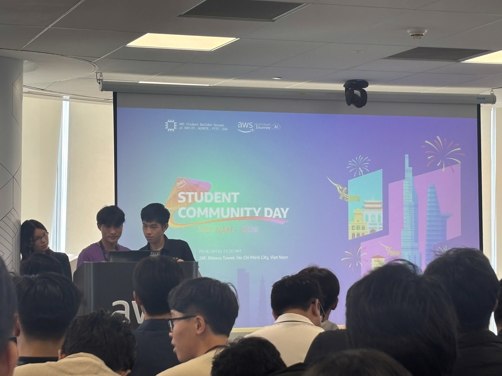
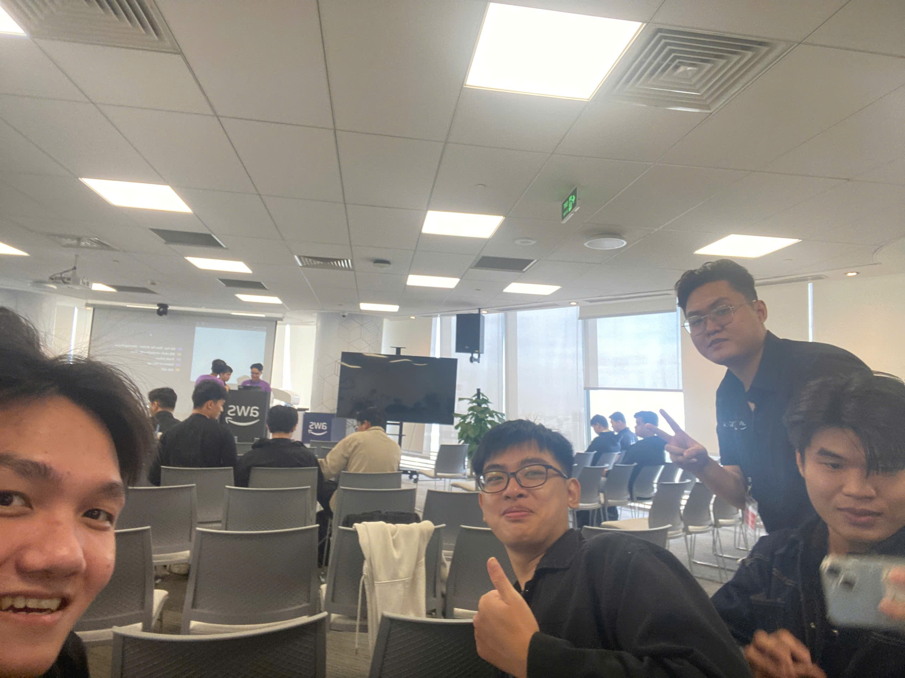
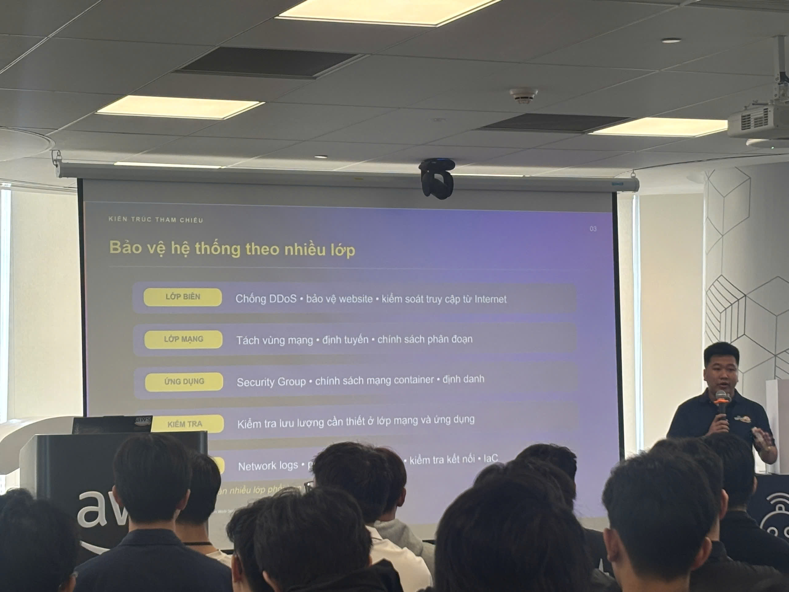
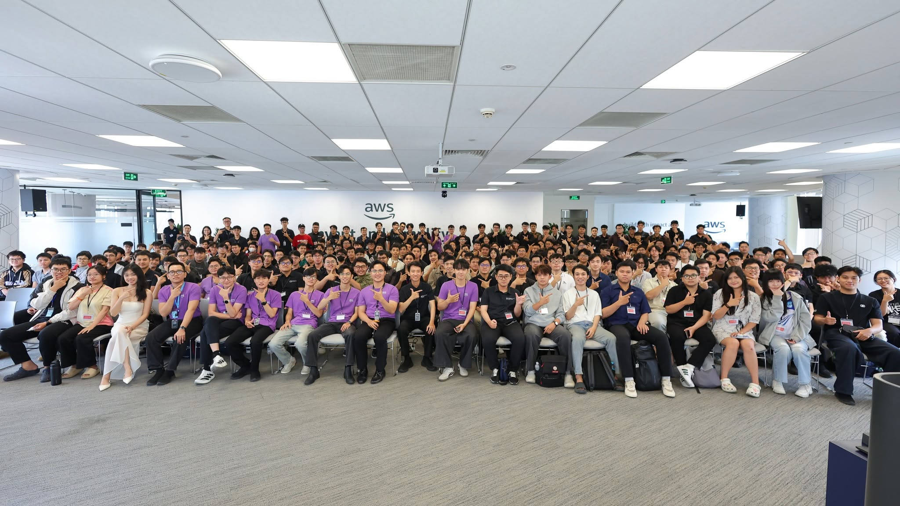

# AWS Student Community Day Vietnam 2026

## Event information

- **Date** — Saturday, November 21, 2026, 09:00–11:30.
- **Venue** — 26th floor, Bitexco Tower, Ho Chi Minh City.
- **My role** — Attendee.

I attended AWS Student Community Day to learn how student groups turn cloud training into projects and to see how a speaker approaches network security on AWS. The event brought together representatives from four AWS Student Builder Groups, with technical talks, student presentations, and short cloud knowledge challenges.

## 1. Builder journeys across four universities

Representatives from four AWS Student Builder Groups shared their experiences in the student cloud community. The participating groups were HCMUTE (Ho Chi Minh City University of Technology and Education), HUFLIT, PTIT HCM, and SGU (Saigon University). The session gave me a chance to learn about communities beyond my own university.

## 2. Layered network security on AWS

The technical talk discussed separating systems, matching controls to risk, and checking them continuously. The reference slide illustrated how each layer handles a different part of the problem.

- **Edge** — Protect the public website and control traffic arriving from the internet.
- **Network** — Segment the environment and review which routes connect its parts.
- **Application** — Use security groups and identity controls to limit access to workloads.
- **Verification** — Check connectivity, review network logs, and keep infrastructure changes reviewable through infrastructure as code.

My takeaway was to start by listing the connections an application needs. Reviewing both a connection that should succeed and one that should be blocked makes the intended rule easier to verify after a configuration change.

## 3. Student projects and activities

In **Unlocking Prove It**, Ngũ Hành Team looked back on its experience earning second runner-up in the Prove It competition. I took this as a reminder that a project presentation should show what the team tried, how it made decisions, and what it learned along the way.

**Quiz Quest** and **Word Quest** gave attendees a way to review cloud and AWS concepts. The event also created time for students from different universities to exchange experiences and find people with related interests.

## What I took away

For MediMind Clinical AI, I can apply the security talk by documenting the expected paths from the public entry point to the application and database. In a test environment, I would verify both the permitted paths and the expected isolation of the database. For the workshop report, I would also keep a short record of architecture decisions and the evidence used to verify them so another student can follow the reasoning.

## Event photos

