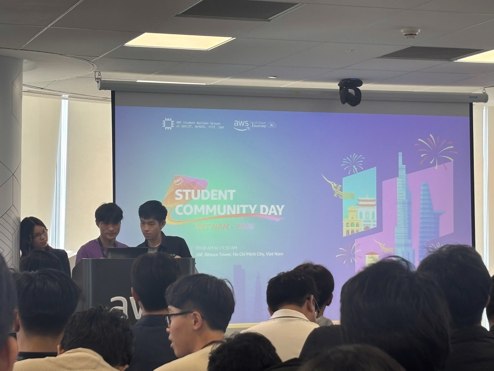
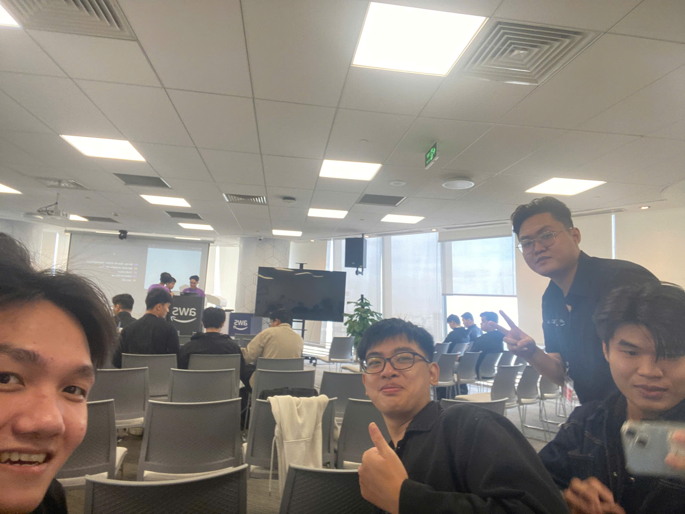
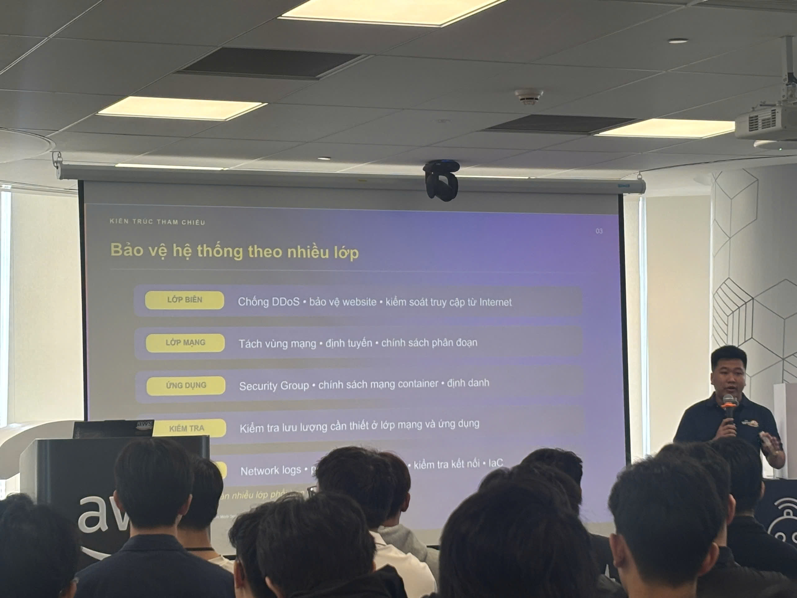
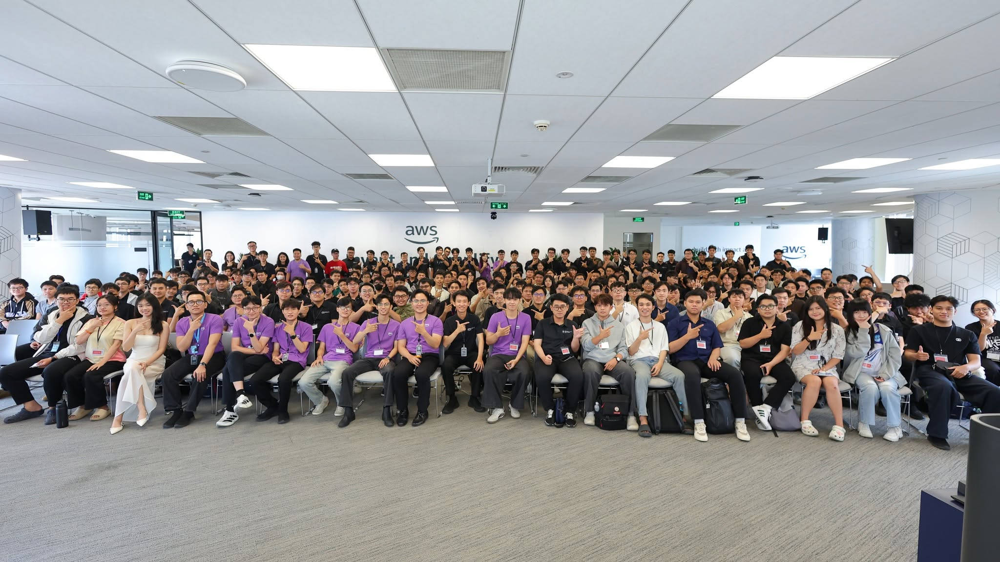

# AWS Student Community Day Vietnam 2026

## Thông tin sự kiện

- **Thời gian** — Thứ Bảy, ngày 21/11/2026, từ 09:00 đến 11:30.
- **Địa điểm** — Tầng 26, văn phòng AWS tại TP. Hồ Chí Minh.
- **Vai trò của tôi** — Người tham dự.

Tôi tham gia AWS Student Community Day để tìm hiểu cách các câu lạc bộ đưa kiến thức cloud vào dự án sinh viên và cách tiếp cận bài toán bảo mật mạng trên AWS. Sự kiện có đại diện từ bốn AWS Student Builder Groups, với các phần chia sẻ kỹ thuật, câu chuyện từ sinh viên và thử thách kiến thức cloud.

## 1. Hành trình Builder từ bốn trường đại học

Đại diện các nhóm AWS Student Builder Group từ HCMUTE (Đại học Sư phạm Kỹ thuật TP.HCM), HUFLIT, PTIT HCM và SGU (Đại học Sài Gòn) chia sẻ về hành trình tham gia cộng đồng sinh viên học cloud. Đây là dịp để tôi tìm hiểu thêm về các nhóm Builder ở những trường khác.

## 2. Bảo mật mạng nhiều lớp trên AWS

Buổi chia sẻ kỹ thuật tập trung vào tách biệt hệ thống, kiểm soát theo mức rủi ro và kiểm tra liên tục. Slide kiến trúc tham chiếu cho thấy mỗi lớp giải quyết một phần của bài toán.

- **Lớp biên** — Bảo vệ website công khai và kiểm soát lưu lượng đến từ Internet.
- **Lớp mạng** — Phân vùng hệ thống và rà soát các tuyến kết nối giữa các vùng.
- **Lớp ứng dụng** — Dùng Security Group và kiểm soát định danh để giới hạn quyền truy cập tài nguyên.
- **Kiểm tra** — Xác minh kết nối, xem nhật ký mạng và lưu thay đổi hạ tầng dưới dạng mã để dễ rà soát.

Điều tôi rút ra là nên liệt kê các kết nối mà ứng dụng thực sự cần trước khi thiết kế quy tắc. Với mỗi thay đổi cấu hình, có thể kiểm tra một kết nối cần được phép và một kết nối cần bị chặn để đối chiếu với thiết kế.

## 3. Kinh nghiệm dự án và hoạt động giao lưu

Trong phần **Unlocking Prove It**, Ngũ Hành Team nhìn lại hành trình đạt vị trí **2nd runner-up** tại cuộc thi Prove It. Phần chia sẻ gợi cho tôi cách trình bày dự án rõ hơn bằng việc ghi lại nhóm đã thử gì, chọn phương án dựa trên điều gì và học được gì trong quá trình làm.

**Quiz Quest** và **Word Quest** giúp người tham dự ôn lại kiến thức AWS và cloud qua các câu hỏi ngắn. Sự kiện cũng tạo dịp để sinh viên nhiều trường trao đổi kinh nghiệm và gặp những người có cùng mối quan tâm.

## Bài học áp dụng vào dự án

Với MediMind Clinical AI, tôi có thể áp dụng phần bảo mật bằng cách mô tả các tuyến kết nối cần thiết từ điểm truy cập công khai đến tầng ứng dụng và cơ sở dữ liệu. Trong môi trường thử nghiệm, tôi sẽ kiểm tra cả tuyến được phép và khả năng cô lập cơ sở dữ liệu. Khi viết báo cáo workshop, tôi cũng có thể ghi lại lý do chọn kiến trúc và kết quả kiểm tra để người đọc theo dõi được quá trình ra quyết định.

## Một số hình ảnh khi tham gia sự kiện

