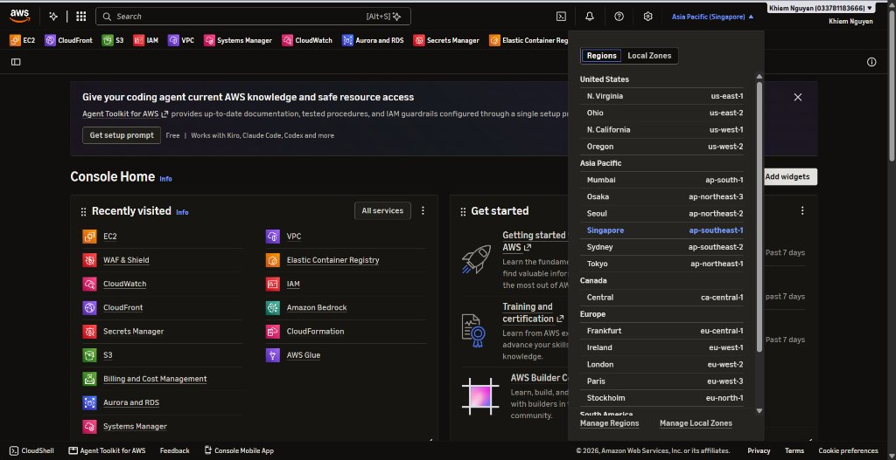
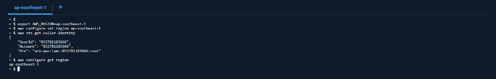

#### Required Accounts & Local Tooling

Before provisioning AWS resources or building the container image, ensure you have:
- **AWS Account** with access to the **Asia Pacific (Singapore) `ap-southeast-1`** region and an IAM user/role authorized to create VPC, EC2, EBS, RDS, S3, ECR, ALB, CloudFront, WAF, Route 53, ACM, Secrets Manager, and CloudWatch resources.
- **Local Workstation Tools:**
  - **AWS CLI v2** (`aws --version`) configured via `aws configure` (`region = ap-southeast-1`).
  - **Docker Engine 24.0+** & **Docker Compose 2.20+** (or Docker Desktop).
  - **Python 3.11+** and **Git** (for running `pytest` and inspecting evaluation scripts locally).
- **AI & Integration Keys:**
  - **Groq API Key** (recommended Dual-Key Failover `GROQ_API_KEY`, `GROQ_API_KEY_2` plus workload-specific keys for `qwen/qwen3.8-27b` on Groq Free Tier) and/or **Google Gemini API Key** (`GEMINI_API_KEY`, optional fallback).
  - *(Optional for full auth/maps)* Google OAuth 2.0 Client ID/Secret, Gmail SMTP App Password, SpeedSMS Auth Token, and Google Maps Platform API Key (Leaflet / OpenStreetMap is active by default).

#### Verify AWS CLI Identity & Select Region `ap-southeast-1`

Before provisioning resources, ensure **Asia Pacific (Singapore) `ap-southeast-1`** is selected in the top-right AWS Management Console region selector and verify your active AWS CLI credentials:



```bash
export AWS_REGION=ap-southeast-1
aws configure set region ap-southeast-1
aws sts get-caller-identity
aws configure get region
```

**Expected Output:**

```json
{
    "UserId": "AIDAXXXXXXXXXXXXXXXXX",
    "Account": "123456789012",
    "Arn": "arn:aws:iam::123456789012:user/workshop-deployer"
}
```
```text
ap-southeast-1
```



#### IAM Permissions Policy for Workshop Deployment

Attach the following IAM policy to the workshop deployment user or group:

{}
This is a streamlined **Lab Provisioning Policy** for learners deploying the workshop infrastructure end-to-end (VPC, EC2, RDS, ALB, CloudFront, WAF, ECR, S3, Secrets Manager, and IAM Roles). The runtime EC2 instance profile **`medimind-ec2-role`** created in **Section 5.3.1** enforces **strict Least Privilege** scoped strictly to `secret:medimind/*`, the backup S3 bucket `medimind-clinical-backup-*`, and `/medimind/*` CloudWatch log groups.
{}

```json
{
  "Version": "2012-10-17",
  "Statement": [
    {
      "Sid": "MediMindWorkshopProvisioning",
      "Effect": "Allow",
      "Action": [
        "ec2:*",
        "rds:*",
        "elasticloadbalancing:*",
        "s3:*",
        "ecr:*",
        "secretsmanager:*",
        "cloudfront:*",
        "wafv2:*",
        "acm:*",
        "route53:*",
        "logs:*",
        "cloudwatch:*",
        "ssm:*",
        "budgets:*",
        "kms:DescribeKey",
        "kms:ListKeys",
        "kms:ListAliases",
        "kms:CreateGrant",
        "iam:CreateRole",
        "iam:DeleteRole",
        "iam:GetRole",
        "iam:ListRoles",
        "iam:PassRole",
        "iam:AttachRolePolicy",
        "iam:DetachRolePolicy",
        "iam:PutRolePolicy",
        "iam:DeleteRolePolicy",
        "iam:CreateInstanceProfile",
        "iam:GetInstanceProfile",
        "iam:DeleteInstanceProfile",
        "iam:AddRoleToInstanceProfile",
        "iam:RemoveRoleFromInstanceProfile",
        "iam:CreateServiceLinkedRole"
      ],
      "Resource": "*"
    }
  ]
}
```

#### Inspecting the MediMind Codebase & Configuring `.env`

1. Clone or navigate to the MediMind Clinical AI repository and inspect the core structure:

```text
chatbot_medical/
├── app.py                     # Main Flask application & 50+ REST/SPA routes
├── core/
│   ├── main_fastapi.py        # FastAPI gateway (mounted with WSGIMiddleware, /docs, /health, /ready)
│   ├── triage.py              # Double Guardrails, emergency bypass & negation handling
│   ├── pipeline_orchestrator.py # 8-step OCR & clinical interpretation pipeline
│   ├── rag_service.py         # Hybrid BM25 + ChromaDB + BGE Reranker service
│   ├── nutrition_service.py   # Deterministic Fail-Closed Allergy Filtering on 2,500 Mon Ngon Moi Ngay recipes
│   ├── circuit_breaker.py     # 3-state AI Circuit Breaker (CLOSED / OPEN / HALF_OPEN)
│   ├── storage_service.py     # Magic-byte & anti-Zip/Decompression Bomb validation
│   └── models.py              # 7 SQLAlchemy ORM tables
├── data/                      # 364 RAG documents, 2,500 Mon Ngon Moi Ngay recipes, 2,144 facilities
├── evaluation/                # quality_gates.json & 4 quantitative benchmark datasets
├── monitoring/                # Prometheus, Grafana & Wazuh alert rules
├── tests/                     # 95 automated pytest test files
├── Dockerfile                 # Non-root python:3.11-slim image on port 8000
├── docker-compose.yml         # Local stack with EBS-equivalent volumes
└── ingest.py                  # ChromaDB vector & metadata ingestion script
```

2. Create your `.env` file from `.env.example` and verify the critical runtime parameters (if `.env.example` contains a duplicate `GROQ_MODEL` block, ensure `qwen/qwen3.8-27b` takes precedence):

```bash
cp .env.example .env
```

Key environment variables used in both local Docker verification and AWS production (`core/settings.py`):

| Variable | Dev / Local Value | AWS Production Value | Purpose |
| :--- | :--- | :--- | :--- |
| `SECRET_KEY` | Random 64-char hex | From Secrets Manager | Flask session & CSRF signing key |
| `DATABASE_URL` | `sqlite:///./instance/medimind.db` | `postgresql+psycopg2://...` | SQLAlchemy DB URI (RDS `:5432` in AWS) |
| `PORT` / `HOST` | `8000` / `0.0.0.0` | `8000` / `0.0.0.0` | Uvicorn/FastAPI listening socket |
| `TRUST_PROXY_HEADERS` | `false` | `true` | Honors CloudFront/ALB `X-Forwarded-*` headers |
| `TRUSTED_PROXY_COUNT` | `1` | `2` *(1 if ALB-only)* | Proxy hop count (`CloudFront + ALB = 2`) to extract true client IP |
| `SESSION_COOKIE_SECURE` | `false` | `true` | Enforces HTTPS-only session cookies |
| `CORS_ALLOWED_ORIGINS` | `http://localhost:8000` | `https://medimind.yourdomain.com` | Restricts cross-origin API callers |
| `AI_PROVIDER` | `groq` | `groq` | Routes AI inference to Groq (optional `gemini` fallback) |
| `GROQ_MODEL` | `qwen/qwen3.8-27b` | `qwen/qwen3.8-27b` | Primary model for Chat, Vision OCR & Nutrition |
| `GROQ_API_KEY` / `GROQ_API_KEY_2` | Personal Groq keys | From Secrets Manager | Dual-Key Failover pair (plus Chat/OCR/Nutrition workload keys) |
| `REDIS_URL` *(optional)* | *(Empty — local/DB fallback)* | `redis://<ELASTICACHE_HOST>:6379/0` | Shared OTP & rate-limit state across Multi-EC2 nodes |
| `VECTOR_DB_PATH` | `./medical_vectordb` | `/app/medical_vectordb` | Persistent ChromaDB directory on EBS |
| `AI_CIRCUIT_BREAKER_ENABLED` | `true` | `true` | Enables fail-fast fallback after 5 errors |

#### Local Smoke Test with Docker Compose

Verify that the container builds, ingests the ChromaDB knowledge base, and passes liveness/readiness probes locally before deploying to AWS:

```bash
# 1. Start the containerized FastAPI + Flask application on port 8000
docker compose up -d

# 2. Build the ChromaDB vector index from the 364 curated medical documents
docker compose run --rm medical-api python ingest.py

# 3. Verify health, readiness, and API documentation endpoints
curl -f http://localhost:8000/health
curl -f http://localhost:8000/ready
```

**Expected Output:**

```text
# docker compose run --rm medical-api python ingest.py
[+] Vector index built: 364 medical documents stored at /app/medical_vectordb

# curl -f http://localhost:8000/health & /ready
{"status":"ok"}
{"status":"ready","rag":"ready","gemini":"ready","circuit_breaker":"CLOSED"}
```

{}
After `docker compose up -d` succeeds in Local Dev, you can preview the Web SPA at `http://localhost:8000`, Swagger UI at `http://localhost:8000/docs`, and the local observability dashboard at `http://localhost:8000/system`. Note that in Production (`FLASK_ENV=production`), `core/main_fastapi.py` automatically disables `/docs`, `/redoc`, and `/openapi.json` for hardening.
{}
