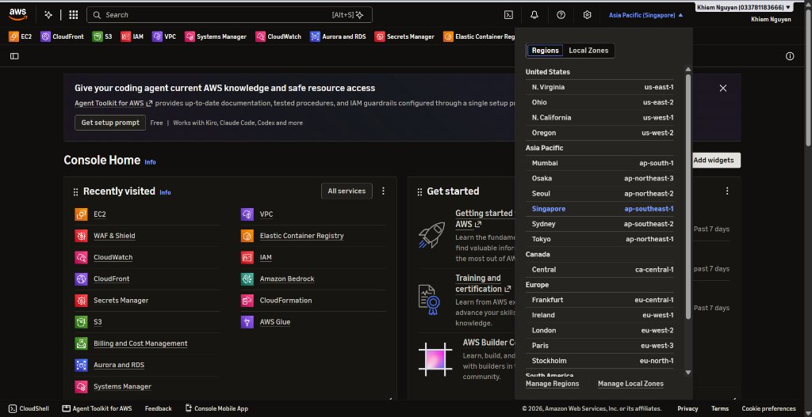
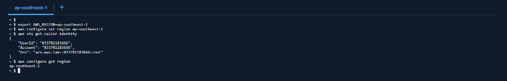

#### Tài khoản & Công cụ Cần thiết

Trước khi khởi tạo hạ tầng AWS hoặc build Docker image, bạn cần chuẩn bị đầy đủ các thành phần sau:
- **Tài khoản AWS** có quyền truy cập khu vực **Asia Pacific (Singapore) `ap-southeast-1`** để khởi tạo VPC, EC2, EBS, RDS, S3, ECR, ALB, CloudFront, WAF, Route 53, ACM, Secrets Manager và CloudWatch.
- **Công cụ trên máy trạm (Workstation):**
  - **AWS CLI v2** (`aws --version`) đã cấu hình qua `aws configure` (`region = ap-southeast-1`).
  - **Docker Engine 24.0+** & **Docker Compose 2.20+** (hoặc Docker Desktop).
  - **Python 3.11+** và **Git** để chạy `pytest` và kiểm tra dữ liệu đánh giá cục bộ.
- **Khóa API AI & Dịch vụ Tích hợp:**
  - **Groq API Key** (khuyến nghị 2 khóa dự phòng Dual-Key Failover `GROQ_API_KEY`, `GROQ_API_KEY_2` và khóa tách theo tác vụ cho mô hình `qwen/qwen3.8-27b` trên Free Tier) và/hoặc **Google Gemini API Key** (`GEMINI_API_KEY`, tùy chọn dự phòng).
  - *(Tùy chọn cho đăng nhập & bản đồ nâng cao)* Google OAuth 2.0 Client ID/Secret, Gmail SMTP App Password, SpeedSMS Auth Token và Google Maps Platform API Key (mặc định dùng Leaflet / OpenStreetMap).

#### Xác thực Tài khoản AWS CLI & Kiểm tra Region `ap-southeast-1`

Trước khi tạo tài nguyên, hãy chọn đúng khu vực **Asia Pacific (Singapore) `ap-southeast-1`** trên thanh góc phải AWS Management Console và xác thực danh tính AWS CLI trên terminal:



```bash
export AWS_REGION=ap-southeast-1
aws configure set region ap-southeast-1
aws sts get-caller-identity
aws configure get region
```

**Expected Output:**

```json
{
    "UserId": "AIDAXXXXXXXXXXXXXXXXX",
    "Account": "123456789012",
    "Arn": "arn:aws:iam::123456789012:user/workshop-deployer"
}
```
```text
ap-southeast-1
```



#### Chính sách Quyền IAM cho Triển khai Workshop

Gắn chính sách IAM sau vào tài khoản/nhóm triển khai Workshop:

{}
Chính sách dưới đây là **Lab Provisioning Policy** rút gọn để người học thuận tiện khởi tạo toàn bộ hạ tầng bài lab (VPC, EC2, RDS, ALB, CloudFront, WAF, ECR, S3, Secrets Manager, IAM Role). Khi ứng dụng chạy thực tế ở bước **5.3.1**, máy chủ EC2 chỉ sử dụng IAM Role **`medimind-ec2-role`** với quyền **strict Least Privilege** (chỉ đọc `secret:medimind/*`, ghi/đọc bucket sao lưu `medimind-clinical-backup-*` và đẩy log `/medimind/*`).
{}

```json
{
  "Version": "2012-10-17",
  "Statement": [
    {
      "Sid": "MediMindWorkshopProvisioning",
      "Effect": "Allow",
      "Action": [
        "ec2:*",
        "rds:*",
        "elasticloadbalancing:*",
        "s3:*",
        "ecr:*",
        "secretsmanager:*",
        "cloudfront:*",
        "wafv2:*",
        "acm:*",
        "route53:*",
        "logs:*",
        "cloudwatch:*",
        "ssm:*",
        "budgets:*",
        "kms:DescribeKey",
        "kms:ListKeys",
        "kms:ListAliases",
        "kms:CreateGrant",
        "iam:CreateRole",
        "iam:DeleteRole",
        "iam:GetRole",
        "iam:ListRoles",
        "iam:PassRole",
        "iam:AttachRolePolicy",
        "iam:DetachRolePolicy",
        "iam:PutRolePolicy",
        "iam:DeleteRolePolicy",
        "iam:CreateInstanceProfile",
        "iam:GetInstanceProfile",
        "iam:DeleteInstanceProfile",
        "iam:AddRoleToInstanceProfile",
        "iam:RemoveRoleFromInstanceProfile",
        "iam:CreateServiceLinkedRole"
      ],
      "Resource": "*"
    }
  ]
}
```

#### Kiểm tra Mã nguồn MediMind & Cấu hình `.env`

1. Truy cập thư mục mã nguồn dự án MediMind Clinical AI và rà soát cấu trúc:

```text
chatbot_medical/
├── app.py                     # Máy chủ Flask chính & hơn 50 route REST/SPA
├── core/
│   ├── main_fastapi.py        # FastAPI gateway (gắn WSGIMiddleware, /docs, /health, /ready)
│   ├── triage.py              # Double Guardrails, cờ đỏ cấp cứu & xử lý bẫy phủ định
│   ├── pipeline_orchestrator.py # Pipeline OCR & diễn giải lâm sàng 8 bước
│   ├── rag_service.py         # Dịch vụ Hybrid RAG (BM25 + ChromaDB + BGE Reranker)
│   ├── nutrition_service.py   # Lọc dị ứng tất định Fail-Closed trên 2.500 món Món Ngon Mỗi Ngày
│   ├── circuit_breaker.py     # Bộ ngắt mạch AI 3 trạng thái (CLOSED / OPEN / HALF_OPEN)
│   ├── storage_service.py     # Kiểm tra Magic Bytes & chống Zip/Decompression Bomb
│   └── models.py              # 7 bảng dữ liệu SQLAlchemy ORM
├── data/                      # 364 tài liệu RAG, 2.500 món Món Ngon Mỗi Ngày, 2.144 cơ sở y tế
├── evaluation/                # quality_gates.json & 4 bộ dữ liệu benchmark định lượng
├── monitoring/                # Cấu hình Prometheus, Grafana & luật cảnh báo Wazuh
├── tests/                     # 95 tệp kiểm thử tự động pytest
├── Dockerfile                 # Image python:3.11-slim chạy quyền non-root appuser cổng 8000
├── docker-compose.yml         # Cấu hình chạy cục bộ với volume tương đương EBS
└── ingest.py                  # Script nạp chỉ mục vector ChromaDB
```

2. Tạo tệp `.env` từ `.env.example` và rà soát các biến môi trường trọng yếu (lưu ý nếu `.env.example` có dòng trùng `GROQ_MODEL`, hãy giữ giá trị `qwen/qwen3.8-27b` ở phần trên):

```bash
cp .env.example .env
```

Bảng đối chiếu biến môi trường giữa Local Dev và AWS Production (`core/settings.py`):

| Biến môi trường | Giá trị Local Dev | Giá trị AWS Production | Vai trò |
| :--- | :--- | :--- | :--- |
| `SECRET_KEY` | Chuỗi hex 64 ký tự ngẫu nhiên | Đọc từ Secrets Manager | Khóa ký Session Flask & CSRF token |
| `DATABASE_URL` | `sqlite:///./instance/medimind.db` | `postgresql+psycopg2://...` | Chuỗi kết nối CSDL (RDS `:5432` trên AWS) |
| `PORT` / `HOST` | `8000` / `0.0.0.0` | `8000` / `0.0.0.0` | Cổng lắng nghe của Uvicorn/FastAPI |
| `TRUST_PROXY_HEADERS` | `false` | `true` | Tin cậy header `X-Forwarded-*` từ CloudFront/ALB |
| `TRUSTED_PROXY_COUNT` | `1` | `2` *(1 nếu chỉ qua ALB)* | Số lớp proxy (`CloudFront + ALB = 2`) để cắt đúng IP khách |
| `SESSION_COOKIE_SECURE` | `false` | `true` | Bắt buộc Cookie chỉ truyền qua HTTPS |
| `CORS_ALLOWED_ORIGINS` | `http://localhost:8000` | `https://medimind.yourdomain.com` | Giới hạn domain được phép gọi API cross-origin |
| `AI_PROVIDER` | `groq` | `groq` | Điều hướng suy luận AI qua Groq (hỗ trợ fallback `gemini`) |
| `GROQ_MODEL` | `qwen/qwen3.8-27b` | `qwen/qwen3.8-27b` | Mô hình chính cho Chat, Vision OCR & Dinh dưỡng |
| `GROQ_API_KEY` / `GROQ_API_KEY_2` | Khóa Groq cá nhân | Đọc từ Secrets Manager | Cặp khóa Dual-Key Failover (và khóa tách riêng Chat/OCR/Nutrition) |
| `REDIS_URL` *(tùy chọn)* | *(Trống — dùng DB/bộ nhớ cục bộ)* | `redis://<ELASTICACHE_HOST>:6379/0` | Chia sẻ trạng thái OTP & Rate Limiting khi chạy Multi-EC2 |
| `VECTOR_DB_PATH` | `./medical_vectordb` | `/app/medical_vectordb` | Thư mục lưu chỉ mục ChromaDB trên EBS |
| `AI_CIRCUIT_BREAKER_ENABLED` | `true` | `true` | Tự động ngắt mạch chuyển Fallback sau 5 lỗi |

#### Kiểm thử Khởi chạy Cục bộ với Docker Compose

Xác nhận container build thành công, nạp được chỉ mục ChromaDB và vượt qua các endpoint kiểm tra sức khỏe trước khi đưa lên AWS:

```bash
# 1. Khởi chạy ứng dụng FastAPI + Flask bằng Docker Compose trên cổng 8000
docker compose up -d

# 2. Nạp chỉ mục ChromaDB từ 364 tài liệu y khoa chuẩn hóa
docker compose run --rm medical-api python ingest.py

# 3. Kiểm tra liveness và readiness probe
curl -f http://localhost:8000/health
curl -f http://localhost:8000/ready
```

**Expected Output:**

```text
# docker compose run --rm medical-api python ingest.py
[+] Vector index built: 364 medical documents stored at /app/medical_vectordb

# curl -f http://localhost:8000/health & /ready
{"status":"ok"}
{"status":"ready","rag":"ready","gemini":"ready","circuit_breaker":"CLOSED"}
```

{}
Sau khi `docker compose up -d` chạy ổn định ở Local Dev, bạn có thể mở Web SPA tại `http://localhost:8000`, Swagger UI tại `http://localhost:8000/docs` và trang giám sát tại `http://localhost:8000/system`. Lưu ý khi lên Production (`FLASK_ENV=production`), `core/main_fastapi.py` sẽ tự động đóng `/docs`, `/redoc` và `/openapi.json` để bảo mật.
{}
