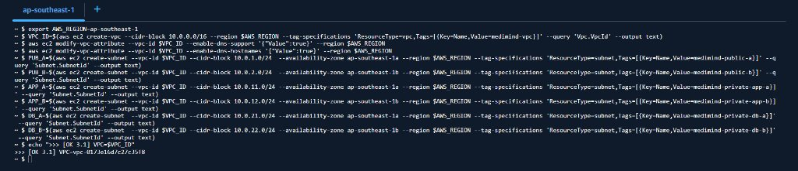
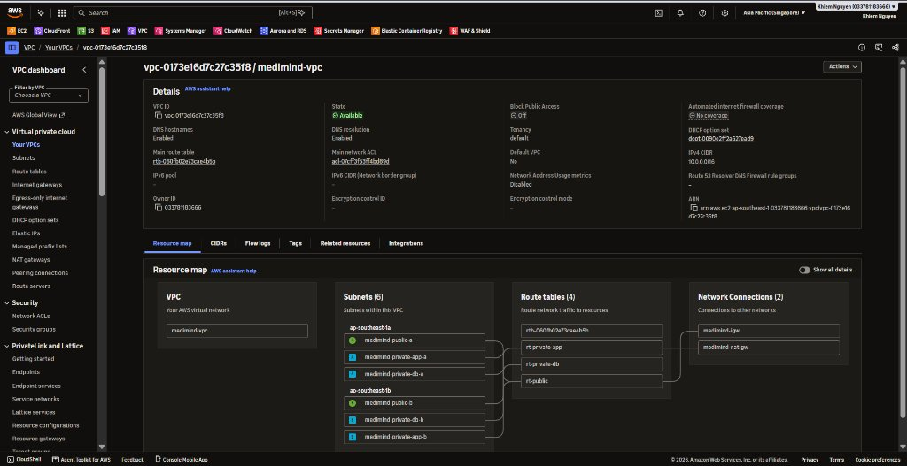
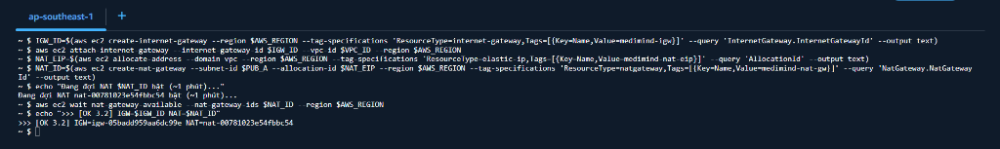
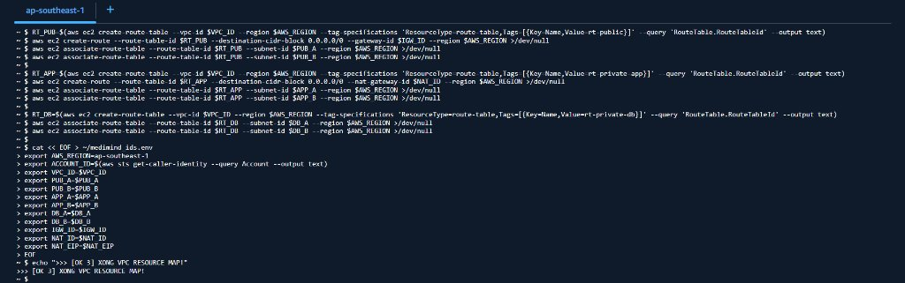
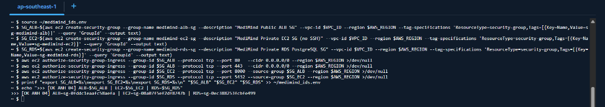
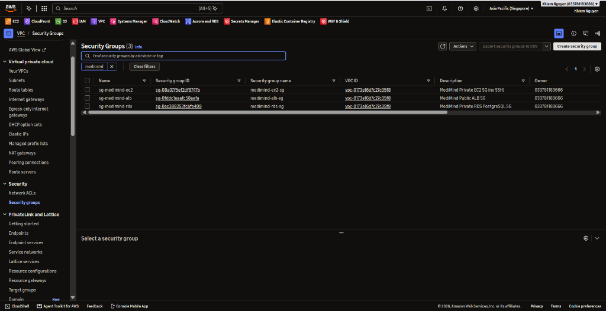
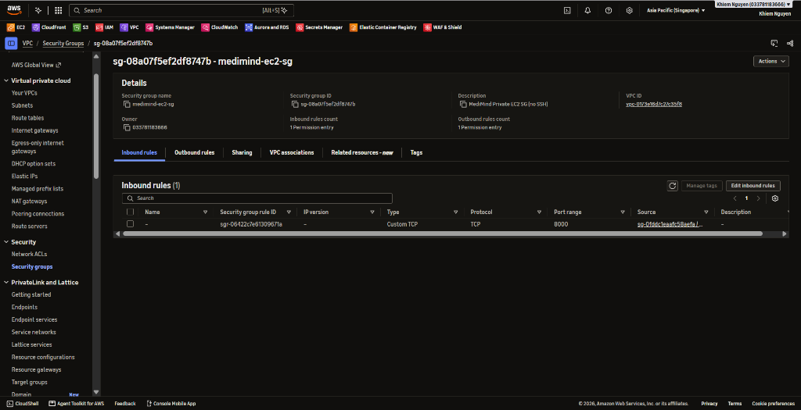
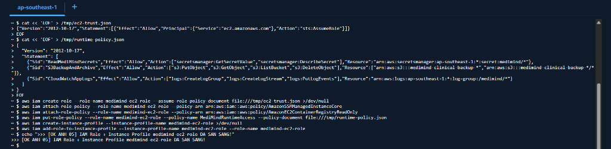
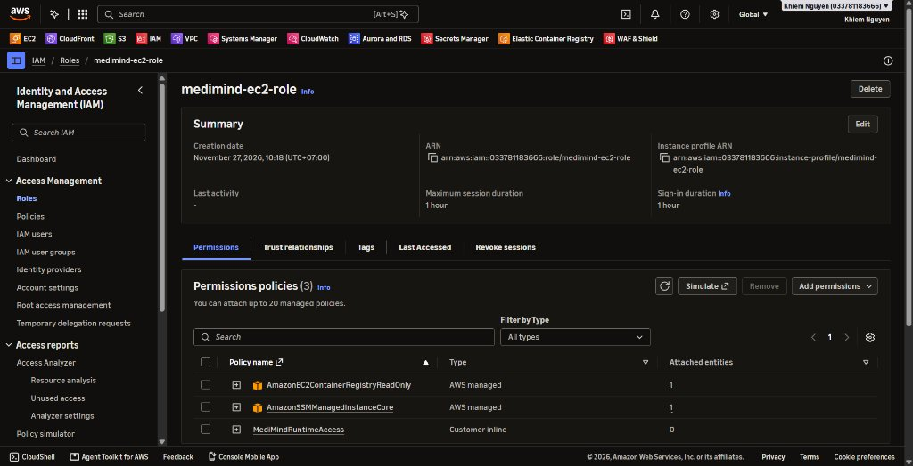

#### Step 1: Create VPC & Six Subnets Across Two Availability Zones

1. Open the **Amazon VPC Console** in `ap-southeast-1` (Singapore) -> go to **Your VPCs** -> **Create VPC**:
   - Select **VPC only**, set **Name tag:** `medimind-vpc`, **IPv4 CIDR block:** `10.0.0.0/16` -> click **Create VPC**.
   - Open **Actions -> Edit VPC settings** -> enable both **Enable DNS resolution** and **Enable DNS hostnames** -> **Save** (or via CLI):

```bash
export AWS_REGION=ap-southeast-1

VPC_ID=$(aws ec2 create-vpc --cidr-block 10.0.0.0/16 \
  --tag-specifications 'ResourceType=vpc,Tags=[{Key=Name,Value=medimind-vpc}]' \
  --query 'Vpc.VpcId' --output text --region $AWS_REGION)

aws ec2 modify-vpc-attribute --vpc-id $VPC_ID --enable-dns-support '{"Value":true}'
aws ec2 modify-vpc-attribute --vpc-id $VPC_ID --enable-dns-hostnames '{"Value":true}'
```

2. Go to **VPC -> Subnets -> Create subnet**, select `medimind-vpc`, and create **6 subnets** spanning `ap-southeast-1a` and `ap-southeast-1b`:

| Subnet Name | Availability Zone | CIDR Block | Tier Role |
| :--- | :--- | :--- | :--- |
| `medimind-public-a` | `ap-southeast-1a` | `10.0.1.0/24` | ALB & NAT Gateway |
| `medimind-public-b` | `ap-southeast-1b` | `10.0.2.0/24` | ALB High Availability |
| `medimind-private-app-a` | `ap-southeast-1a` | `10.0.11.0/24` | Amazon EC2 + EBS |
| `medimind-private-app-b` | `ap-southeast-1b` | `10.0.12.0/24` | Standby App Subnet |
| `medimind-private-db-a` | `ap-southeast-1a` | `10.0.21.0/24` | RDS PostgreSQL Primary |
| `medimind-private-db-b` | `ap-southeast-1b` | `10.0.22.0/24` | RDS DB Subnet Group |





#### Step 2: Internet Gateway, NAT Gateway & Route Tables

1. **Internet Gateway:** Go to **VPC -> Internet gateways -> Create internet gateway** -> Name `medimind-igw` -> **Actions -> Attach to VPC** (`medimind-vpc`).
2. **NAT Gateway:** Go to **VPC -> NAT gateways -> Create NAT gateway**:
   - **Name:** `medimind-nat-gw` | **Subnet:** `medimind-public-a` | **Connectivity type:** `Public` -> click **Allocate Elastic IP** -> **Create NAT gateway**.
   - This lets private EC2 instances pull ECR images and call Groq API (and Gemini fallback), Google OAuth, Gmail SMTP, and SpeedSMS without accepting any inbound Internet connections.
3. **Route Tables:** Go to **VPC -> Route tables -> Create route table** to create 3 route tables; under each table open the **Subnet associations -> Edit subnet associations** tab and the **Routes -> Edit routes** tab for `0.0.0.0/0`:

| Route Table | Associated Subnets | Destination `0.0.0.0/0` Target | Local Target |
| :--- | :--- | :--- | :--- |
| `rt-public` | `medimind-public-a`, `medimind-public-b` | `medimind-igw` | `10.0.0.0/16 -> local` |
| `rt-private-app` | `medimind-private-app-a`, `medimind-private-app-b` | `medimind-nat-gw` | `10.0.0.0/16 -> local` |
| `rt-private-db` | `medimind-private-db-a`, `medimind-private-db-b` | *None (completely isolated)* | `10.0.0.0/16 -> local` |

{}
Because **Amazon RDS** requires subnets in at least two Availability Zones for a DB Subnet Group, always associate both `medimind-private-db-a` and `medimind-private-db-b` with `rt-private-db`.
{}





#### Step 3: Configure Chained Security Groups

Go to **VPC -> Security Groups -> Create security group** (select `medimind-vpc`), create the 3 Security Groups below, and configure their **Inbound rules** and **Outbound rules** tabs so each tier only trusts the Security Group ID of the tier above it:

| Security Group | Inbound Rules (Protocol / Port / Source) | Outbound Rules |
| :--- | :--- | :--- |
| `sg-medimind-alb` | `HTTPS (443)` and `HTTP (80)` from CloudFront Prefix List / `0.0.0.0/0` | `TCP 8000` to `sg-medimind-ec2` |
| `sg-medimind-ec2` | `TCP 8000` **only** from `sg-medimind-alb` *(no SSH port 22 exposed)* | `TCP 5432` to `sg-medimind-rds`; `HTTPS (443)` & `587` (SMTP) outbound via NAT |
| `sg-medimind-rds` | `TCP 5432` **only** from `sg-medimind-ec2` | Restricted (`10.0.0.0/16` or default) |







#### Step 4: Create the `medimind-ec2-role` IAM Role & Instance Profile

Open **IAM Console -> Roles -> Create role** -> **Trusted entity type:** `AWS service`, **Use case:** `EC2` -> name it **`medimind-ec2-role`** (Console auto-creates the matching Instance Profile; afterward open **Permissions -> Add permissions -> Create inline policy -> JSON tab** to attach the third policy) with **strict Least Privilege**:
1. Managed policy **`AmazonSSMManagedInstanceCore`** (enables browser/CLI shell access via **Session Manager** with zero open SSH ports).
2. Managed policy **`AmazonEC2ContainerRegistryReadOnly`** (allows pulling private images from Amazon ECR).
3. Inline policy **`MediMindRuntimeAccess`** granting least-privilege access to Secrets Manager (`medimind/*`), the S3 backup bucket, and CloudWatch Logs:

```json
{
  "Version": "2012-10-17",
  "Statement": [
    {
      "Sid": "ReadMediMindSecrets",
      "Effect": "Allow",
      "Action": ["secretsmanager:GetSecretValue", "secretsmanager:DescribeSecret"],
      "Resource": "arn:aws:secretsmanager:ap-southeast-1:*:secret:medimind/*"
    },
    {
      "Sid": "S3BackupAndArchive",
      "Effect": "Allow",
      "Action": ["s3:PutObject", "s3:GetObject", "s3:ListBucket", "s3:DeleteObject"],
      "Resource": [
        "arn:aws:s3:::medimind-clinical-backup-*",
        "arn:aws:s3:::medimind-clinical-backup-*/*"
      ]
    },
    {
      "Sid": "CloudWatchAppLogs",
      "Effect": "Allow",
      "Action": ["logs:CreateLogGroup", "logs:CreateLogStream", "logs:PutLogEvents"],
      "Resource": "arn:aws:logs:ap-southeast-1:*:log-group:/medimind/*"
    }
  ]
}
```




